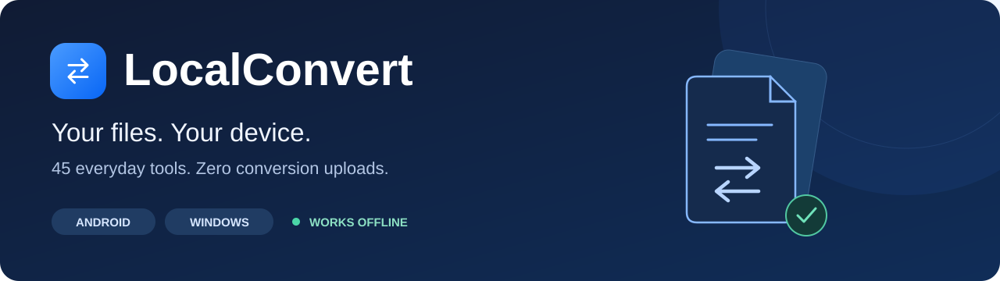
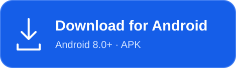
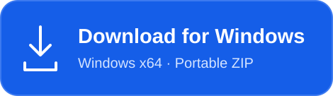
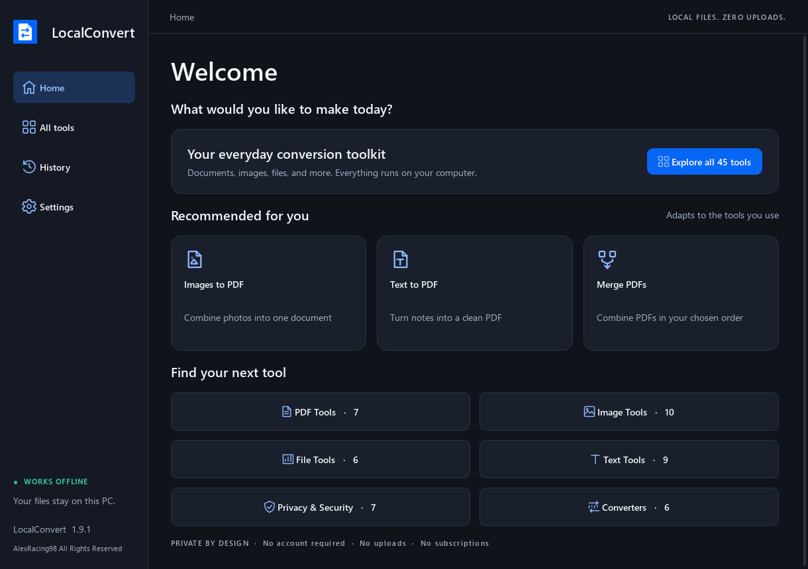
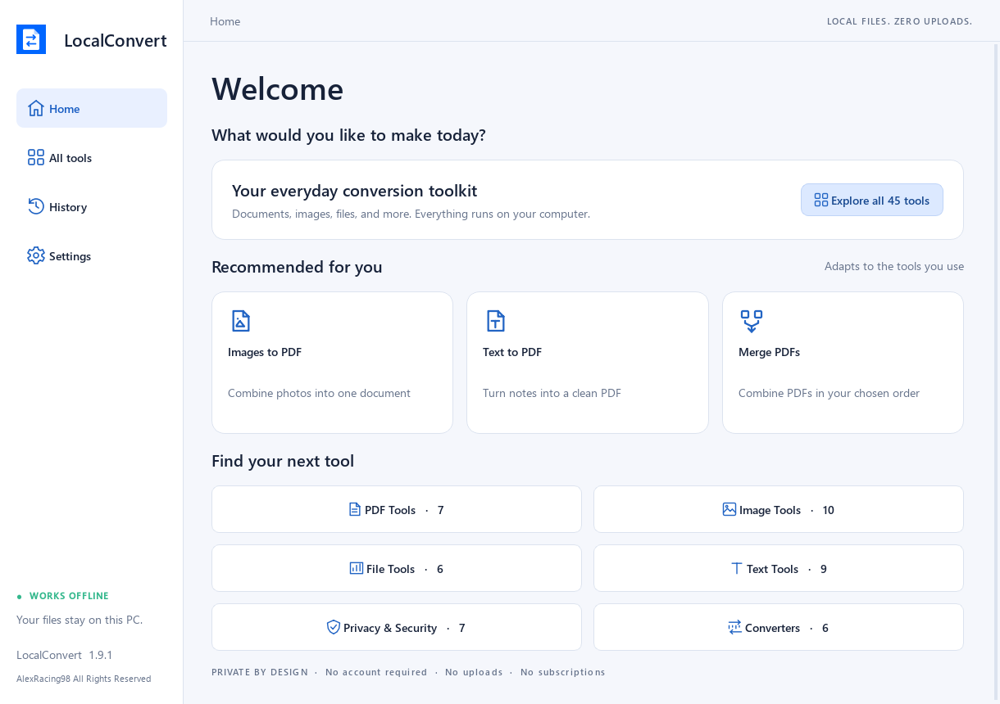

  

  <strong>Convert, edit, and organize your files—right where they belong.</strong> 
  45 everyday tools. Local processing. No account or conversion uploads.

  <a href="#download">Download</a> ·
  <a href="docs/TOOLS.md">Explore the tools</a> ·
  <a href="docs/INSTALLATION.md">Installation</a> ·
  <a href="docs/PRIVACY.md">Privacy</a> ·
  <a href="SUPPORT.md">Get help</a>

## Download

  
  &nbsp;
  

| Platform | Requirements | Get started |
| :-- | :-- | :-- |
| **Android 1.9.1** | Android 8.0 or newer · no Google Play Services required | Download the APK and follow Android’s installation prompts. |
| **Windows 1.9.3** | 64-bit Windows 10, version 1809 or newer, or Windows 11 | Extract the **entire ZIP**, then open **LocalConvert.exe**. Keep the `_internal` folder beside it. |

Windows includes its runtime: no separate Python or Microsoft Office installation is needed. The executable is currently unsigned.

[Android release notes](https://github.com/AlexRacing98/LocalConvert/releases/tag/Official_Release) · [Windows release notes](https://github.com/AlexRacing98/LocalConvert/releases/tag/windows-v1.9.3) · [Installation guide](docs/INSTALLATION.md)

## A workspace that feels like yours

Start with a welcome message, discover recommended tools, and find previous results in History. Add your name, switch between light and dark themes, and reset your recommendations whenever you want a fresh start.

  

<strong>See the light theme</strong>

 

*Windows interface previews rendered from the desktop app. Android adapts the toolkit to a phone-sized layout.*

## One toolkit. Six categories.

| Category | Tools | What you can do |
| :-- | :--: | :-- |
| **PDF Tools** | 7 | Create PDFs from images, export pages as images, merge, split, compress, rotate, and extract pages. |
| **Image Tools** | 10 | Convert PNG/JPG/WebP, resize, crop, compress, remove metadata, and add text watermarks. |
| **File Tools** | 6 | Preview batch renames, find identical duplicates, analyze folders, ZIP/unzip, and sort by file type. |
| **Text Tools** | 9 | Export text to PDF/DOCX, count words and characters, change case, clean and sort lines, and format/validate JSON. |
| **Privacy & Security** | 7 | Generate passwords and QR codes, scan QR codes, encode/decode Base64, and calculate SHA-256 or MD5 checksums. |
| **Converters** | 6 | Convert units, temperature, length, weight, speed, and currencies using dated offline or manual rates. |

[Browse all 45 tools →](docs/TOOLS.md)

## Private by design

- **Processing stays on your device.** Files are not uploaded to a conversion service.
- **No account, ads, or subscriptions.** Open the app and choose a tool.
- **Local recommendations.** Recommendations use recent tool choices on that device; they are not sent to an analytics service.
- **You choose what to share.** Bug reports open an email draft. Sending mail and opening external links happen through your chosen apps.

Currency conversion uses a dated snapshot rather than live rates. You can import a newer ECB-format XML file or enter a manual rate. Base64 is an encoding; MD5 is a legacy checksum. See the [privacy notes](docs/PRIVACY.md) and [tool guide](docs/TOOLS.md) for practical limits.

## Help shape what comes next

Found something that needs fixing? [Report a bug](https://github.com/AlexRacing98/LocalConvert/issues/new?template=bug_report.yml). Have an idea for another useful offline tool? [Suggest a feature](https://github.com/AlexRacing98/LocalConvert/issues/new?template=feature_request.yml).

For help with installation or a private report, see [Support](SUPPORT.md). Changes are listed in the [changelog](CHANGELOG.md).

---

Made by **AlexRacing98**.

**AlexRacing98 All Rights Reserved**. This repository hosts official downloads, documentation, and issue tracking; application source code is not published here. Third-party components retain their own licenses, included with the application packages. See [LICENSE](LICENSE).
